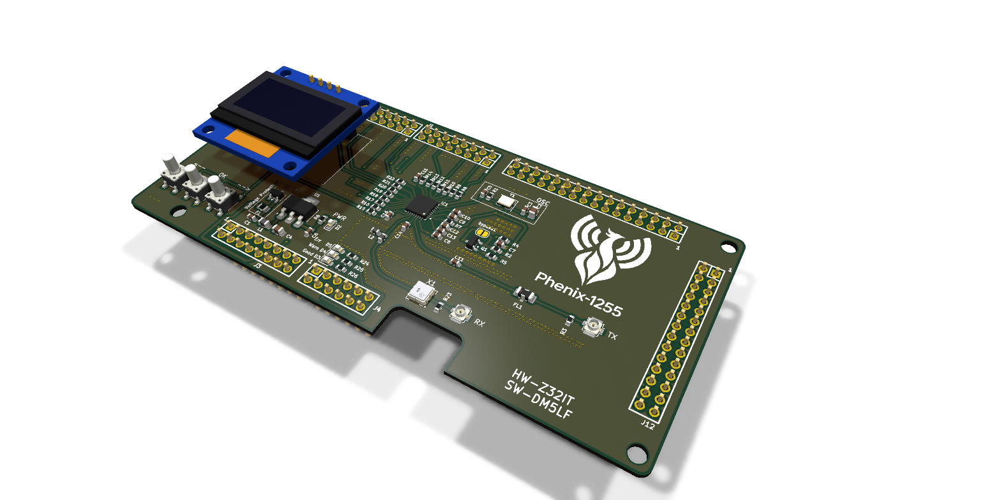
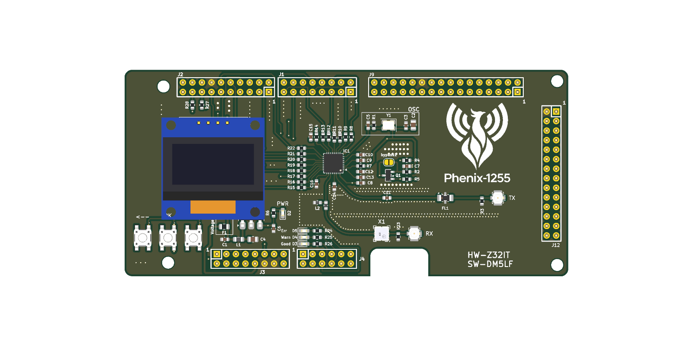
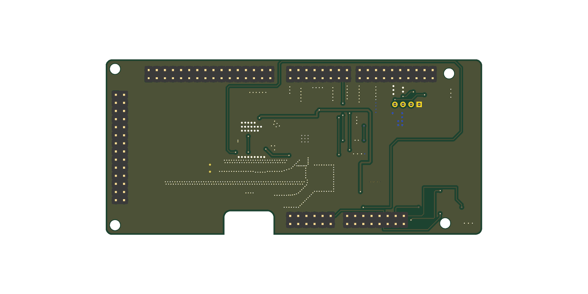
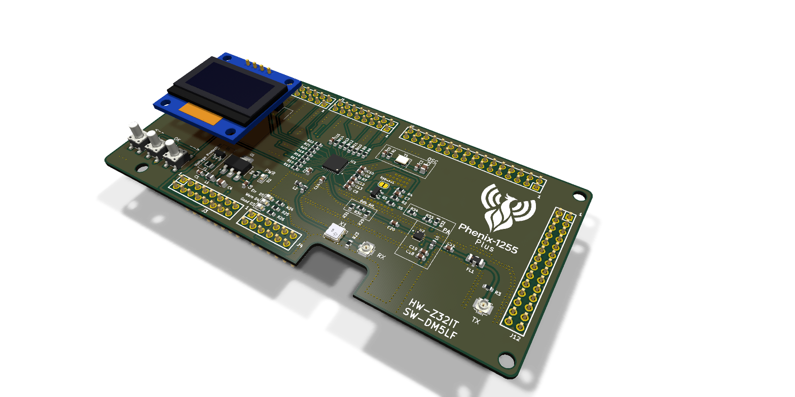
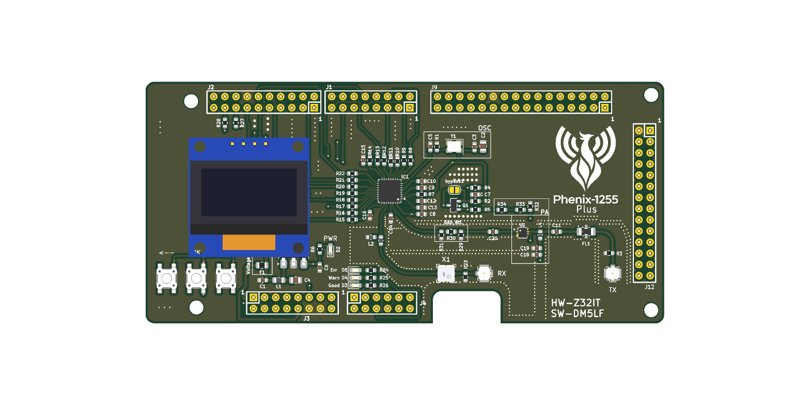
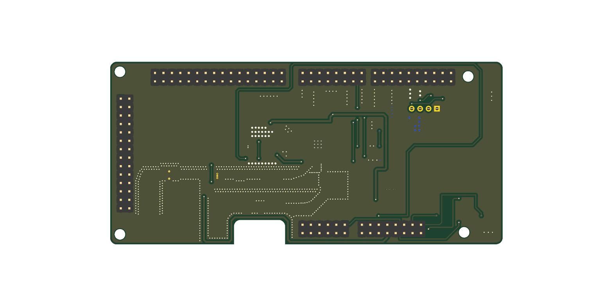

<p align="center">
  <picture>
    <source media="(prefers-color-scheme: dark)" srcset="documentation/images/phenix-1255_logo_white.png">
    
  </picture>
</p>

<p align="center">
  <b>"Pi-less" SX1255 RF shield for the NXP FRDM-MCXN947</b><br>
  KiCad hardware design · separate RX/TX paths · 38.4 MHz TCXO · HS USB or Ethernet via the FRDM board
</p>

<p align="center">
  <a href="LICENSE"></a>
  <a href="https://www.kicad.org/"></a>
  <a href="FRDM-SX1255/FRDM-SX1255-V2.pdf"></a>
  <a href="FRDM-SX1255+"></a>
  <a href="https://github.com/w4tchd0g/phenix-1255-sw"></a>
</p>

<p align="center">
  <a href="#overview">Overview</a> ·
  <a href="#board-variants">Board variants</a> ·
  <a href="#features">Features</a> ·
  <a href="#preview">Preview</a> ·
  <a href="#documentation">Documentation</a> ·
  <a href="#repository-contents">Repository contents</a> ·
  <a href="#getting-started">Getting started</a> ·
  <a href="#license">License</a>
</p>

<p align="center">
  
</p>

## Overview

Phenix-1255 is a shield board that pairs the popular **Semtech SX1255** RF transceiver with the
**NXP FRDM-MCXN947** development board — no Raspberry Pi required. The MCX N947 handles the
I/Q sample stream and talks to the host PC over **High-Speed USB** or **Ethernet**.

The project idea comes from **[DM5LF](https://github.com/w4tchd0g)**, who also writes the software. The hardware was designed by **[Z32IT](https://github.com/labdvm)**.

| | |
|---|---|
| 🧠 **Controller** | NXP FRDM-MCXN947 (plugs directly onto the shield headers) |
| 📡 **RF transceiver** | Semtech SX1255 (I/Q, 400–510 MHz) |
| ⏱️ **Reference clock** | 38.4 MHz TCXO, 0.5–1 ppm |
| 🔌 **Host link** | High-Speed USB 2.0 or Ethernet of the FRDM-MCXN947 |
| ⚡ **Power** | 5 V from the FRDM-MCXN947 (USB-C); PoE operation possible with a 48 V → 5 V USB-C PoE splitter |
| 📐 **PCB** | 118 × 55 mm, 2 layers, 1.2 mm thickness |

## Board variants

The repository contains two variants of revision V2. Both share the same board outline, headers,
power supply, user interface and RX path.

| Variant | Folder | Difference |
|---|---|---|
| **V2** | [`FRDM-SX1255/`](FRDM-SX1255) | SX1255 TX output → low-pass filter → U.FL |
| **V2 Plus** | [`FRDM-SX1255+/`](FRDM-SX1255+) | Additional **TX driver amplifier** (Qorvo TQP3M9036, U2) between the SX1255 and the low-pass filter, with a resistive π-attenuator (R29–R31) at its input. The amplifier runs from 5 V and is switched together with the PA via `~PA_EN`. |

## Features

- **Separate RX and TX paths** with U.FL connectors (*TX* J1, *RX* J2)
  - RX: SAW band-pass filter (Tai-Saw TA0655A, 430 MHz centre frequency, 2 MHz bandwidth) → LC matching → `RFI`
  - TX: `RFO_P` → low-pass filter (Mini-Circuits LFCN-490+) → U.FL; V2 Plus adds the TQP3M9036 driver amplifier
- **Switchable PA supply** – P-MOSFET (BSS84) controlled by `~PA_EN`, with a *bypass* solder jumper
- **Power supply** – resettable 500 mA fuse, TVS diode array (SP0502BAHT), ferrite bead and 3.3 V LDO (MCP1703)
- **User interface**
  - Three push buttons: *←*, *OK*, *→*
  - Socket for an I²C OLED display
  - Status LEDs: *PWR*, *Err*, *Warn*, *Good*

## Preview

### V2

| Top | Bottom |
|:---:|:---:|
|  |  |

### V2 Plus

<p align="center">
  
</p>

| Top | Bottom |
|:---:|:---:|
|  |  |

The images are rendered from the `.kicad_pcb` files with the KiCad 3D renderer and show the fully
assembled board with a 0.96″ OLED module plugged into its socket, including the parts that are
marked *do not populate* in the layout (FRDM headers, OLED socket, SAW filter). After changing the
layout, run [`./scripts/render.sh`](scripts/render.sh) to update the images.

### 3D models

Every part on the board has a 3D model, so the board can be checked mechanically (e.g. for an
enclosure) and exported as STEP from KiCad. Most models come from the KiCad standard library
(`${KICAD10_3DMODEL_DIR}`); parts without a matching library model use these substitutes:

| Part | Footprint | 3D model | Source |
|---|---|---|---|
| FRDM headers J1, J2, J3, J4, J9, J12 | Samtec SSQ (FRDM template) | `PinHeader_2xNN_P2.54mm_Vertical` | KiCad library, mounted below the board |
| U.FL connectors *TX* / *RX* | `U.FL_Molex_MCRF_73412-0110_Vertical` | `U.FL_Hirose_U.FL-R-SMT-1_Vertical`, rotated 90° | KiCad library (no model for the Molex footprint) |
| Push buttons SW1–SW3 | `PTS647SK38SMTR2LFS` | `SW_SPST_PTS647Sx70` (7.0 mm actuator, as in the BOM) | KiCad library |
| SAW filter X1 (TA0655A) | `Filter_SAW-6_3.8x3.8mm` | [`3dmodels/TA0655A.stp`](FRDM-SX1255/3dmodels/TA0655A.stp) | Project file |
| TX amplifier U2 (V2 Plus) | `SON50P200X200X95-9N` | `VDFN-8-1EP_2x2mm_P0.5mm_EP0.9x1.7mm` | KiCad library |
| OLED display (plugged into J5) | `PinSocket_1x04_P2.54mm_Vertical` | [`3dmodels/OLED_0.96in_128x64_I2C.stp`](FRDM-SX1255/3dmodels/OLED_0.96in_128x64_I2C.stp) – 0.96″ 128×64 SSD1306 I²C module, as a second model on the socket | Project file |

Mounting holes and the *bypass* solder jumper need no model.

The shield is designed for the NXP FRDM-MCXN947 development board, see the
[NXP FRDM-MCXN947 product page](https://www.nxp.com/design/design-center/development-boards-and-designs/FRDM-MCXN947)
for photos, documentation and the board pinout.

## Documentation

| Document | Content |
|---|---|
| [Hardware](documentation/hardware.md) | Block overview, header pin assignment, PA supply and *bypass* jumper, power supply, V2 Plus amplifier |
| [Manufacturing and assembly](documentation/manufacturing.md) | PCB specification, production files, assembly notes, first power-up |

## Host PC requirements

| Component | Minimum |
|---|---|
| Interface | USB 2.0 (High-Speed) or Ethernet |
| CPU | Intel or AMD, 4 cores |
| RAM | 4 GB DDR3 |
| Storage | SSD |
| OS | Xubuntu x64 |

## Repository contents

Each board variant is a self-contained KiCad project in its own folder:

```
Phenix-1255-HW/
├── FRDM-SX1255/                      # V2
│   ├── FRDM-SX1255-V2.kicad_pro      # KiCad project – open this one
│   ├── FRDM-SX1255-V2.kicad_sch      # schematic
│   ├── FRDM-SX1255-V2.kicad_pcb      # PCB layout
│   ├── FRDM-SX1255-V2.pdf            # schematic as PDF
│   ├── FRDM-SX1255-V2.png / _b.png   # 2D board views (KiCad export)
│   ├── 3dmodels/                     # project-specific 3D models
│   └── Gerber and BOM/               # manufacturing data
│       ├── …_gerber.zip              # Gerber and drill files for PCB fabrication
│       ├── …_bom.csv                 # bill of materials (incl. DigiKey part numbers)
│       ├── …_positions.csv           # pick-and-place positions for assembly
│       └── …_netlist.ipc             # IPC-D-356 netlist for electrical testing
├── FRDM-SX1255+/                     # V2 Plus – same structure, files named "FRDM-SX1255+ V2.*"
├── documentation/                    # hardware and manufacturing documentation, images
└── scripts/render.sh                 # renders the PCB images (needs kicad-cli)
```

| Quick links | V2 | V2 Plus |
|---|---|---|
| Schematic (PDF) | [`FRDM-SX1255-V2.pdf`](FRDM-SX1255/FRDM-SX1255-V2.pdf) | [`FRDM-SX1255+ V2.pdf`](FRDM-SX1255+/FRDM-SX1255+%20V2.pdf) |
| Gerber | [`…_gerber.zip`](FRDM-SX1255/Gerber%20and%20BOM/FRDM-SX1255-V2.kicad_pcb_gerber.zip) | [`…_gerber.zip`](FRDM-SX1255+/Gerber%20and%20BOM/FRDM-SX1255+%20V2.kicad_pcb_gerber.zip) |
| BOM | [`…_bom.csv`](FRDM-SX1255/Gerber%20and%20BOM/FRDM-SX1255-V2.kicad_pcb_bom.csv) | [`…_bom.csv`](FRDM-SX1255+/Gerber%20and%20BOM/FRDM-SX1255+%20V2.kicad_pcb_bom.csv) |
| Positions | [`…_positions.csv`](FRDM-SX1255/Gerber%20and%20BOM/FRDM-SX1255-V2.kicad_pcb_positions.csv) | [`…_positions.csv`](FRDM-SX1255+/Gerber%20and%20BOM/FRDM-SX1255+%20V2.kicad_pcb_positions.csv) |

## Getting started

1. **Choose a variant** – V2, or V2 Plus if you want the additional TX driver amplifier.
2. **Order the PCB** – upload the Gerber ZIP to a PCB manufacturer of your choice
   (2 layers, **1.2 mm** board thickness). For assembly, provide the BOM and position files as well.
   Details: [Manufacturing and assembly](documentation/manufacturing.md).
3. **Assemble** the shield and plug it onto the FRDM-MCXN947.
4. **Connect antennas / RF cabling** to the U.FL connectors *TX* (J1) and *RX* (J2).
5. **Install the software** from [phenix-1255-sw](https://github.com/w4tchd0g/phenix-1255-sw).

## Related projects

- 💻 **Software:** [w4tchd0g/phenix-1255-sw](https://github.com/w4tchd0g/phenix-1255-sw)

## Credits

- **Idea & software:** DM5LF – [@w4tchd0g](https://github.com/w4tchd0g)
- **Hardware design:** Z32IT – [@labdvm](https://github.com/labdvm)

## License

Copyright © Z32IT 2026.

This source describes Open Hardware and is licensed under the **CERN-OHL-P v2**.

You may redistribute and modify this source and make products using it under the terms of the
[CERN-OHL-P v2](https://ohwr.org/cern_ohl_p_v2.txt). This source is distributed **WITHOUT ANY EXPRESS
OR IMPLIED WARRANTY, INCLUDING OF MERCHANTABILITY, SATISFACTORY QUALITY AND FITNESS FOR A PARTICULAR
PURPOSE**. Please see the CERN-OHL-P v2 for applicable conditions.

Source location: <https://github.com/labdvm/Phenix-1255-HW>
