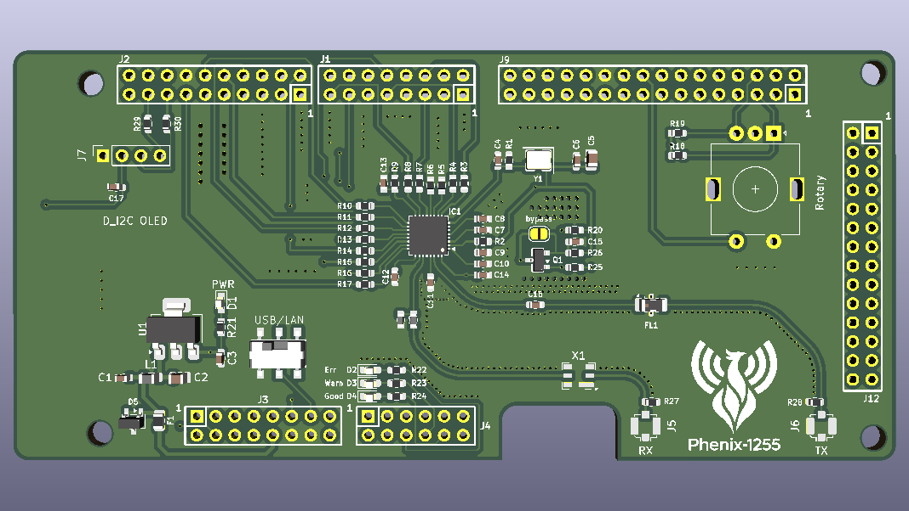
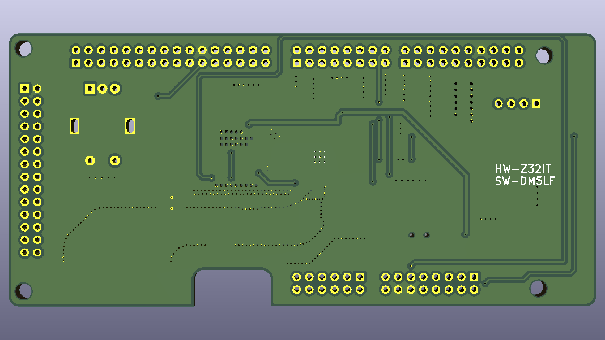

# Hardware

Description of the Phenix-1255 shield, revision **V1.3**. The full schematic is in
[`FRDM-SX1255.pdf`](../FRDM-SX1255.pdf); the firmware view of the same signals is in
[`_doc/hardware.md`](https://github.com/w4tchd0g/phenix-1255-sw/blob/develop/_doc/hardware.md)
of the software repository.

<p align="center">
  
</p>

## Block overview

| Block | Parts | Description |
|---|---|---|
| Transceiver | IC1 (SX1255) | I/Q interface (I2S) and SPI to the MCX N947 |
| Reference clock | Y1 (38.4 MHz TCXO) | Clipped sine, 0.5–1 ppm, footprint fits 3225 and 2520 packages |
| RX path | J5, X1, L2/L3, C | U.FL input → SAW band-pass (TDK B3909) → matching → `RFI` |
| TX path | J6, FL1, C | `RFO_P/N` → matching → low-pass (Mini-Circuits LFCN-490+) → U.FL output |
| PA supply switch | Q1, R20, R25, R26, *bypass* | P-MOSFET switches the SX1255 PA supply (`VBAT3`) |
| Power supply | F1, D5, L1, U1 | 5 V → PTC fuse → TVS → ferrite bead → 3.3 V LDO |
| Host interface select | *USB/LAN* slide switch | Selects HS USB or Ethernet in the firmware |
| User interface | D1–D4, Rotary, J7 | Status LEDs, rotary encoder with push button, OLED header |

## Shield headers

The shield plugs onto the FRDM-MCXN947 with six headers. The pin numbers below are the shield's
pin numbers (see the silkscreen and the schematic). The MCU pins are taken from the firmware's
devicetree overlay. Pins not listed are not connected on the shield.

### J1 – SX1255 I/Q interface and control

| Pin | Signal | SX1255 pin | MCU pin | Function |
|---|---|---|---|---|
| 5 | `I_IN` | I_IN | P3_20 | SAI1_TXD0 – TX samples |
| 6 | `RST` | RESET | P0_29 | SX1255 reset |
| 9 | `CK_OUT` | CK_OUT | P3_18 | SAI1_RX_BCLK – I2S bit clock |
| 10 | `DIO1` | DIO1 | P0_30 | GPIO input |
| 13 | `DIO2` | DIO2 / WS | P3_19 | SAI1_RX_FS – I2S frame sync |
| 15 | `I_OUT` | I_OUT | P3_21 | SAI1_RXD0 – RX samples |
| 16 | `NSS` | NSS | P0_31 | SPI chip select, active low |

### J2 – SPI and OLED I²C

| Pin | Signal | MCU pin | Function |
|---|---|---|---|
| 2 | `DIO0` | P0_28 | SX1255 DIO0, GPIO input |
| 8 | `MOSI` | P0_24 | LPSPI1 SDO |
| 10 | `MISO` | P0_26 | LPSPI1 SDI |
| 12 | `SCK` | P0_25 | LPSPI1 SCK |
| 13 | `DIO3` | P0_19 | SX1255 DIO3, GPIO input |
| 14 | GND | | |
| 15 | `SCL_oled` | P1_1 | LPI2C3 SCL |
| 17 | `SDA_oled` | P1_0 | LPI2C3 SDA |

### J3 – Power and board control

| Pin | Signal | MCU pin | Function |
|---|---|---|---|
| 4 | `3V3_oled` | | 3.3 V supply for the OLED header J7 |
| 10 | `+5V0` | | Main supply of the shield |
| 11 | `~PA_EN` | P2_4 | PA supply enable, active low |
| 12, 14 | GND | | |
| 13 | `USB/LAN` | P2_7 | `COMM_SEL`: open = HS USB, GND = Ethernet |

### J4 – Status LEDs

| Pin | LED | Colour | MCU pin |
|---|---|---|---|
| 6 | D2 *Err* | red | P0_14 |
| 8 | D3 *Warn* | yellow | P0_22 |
| 10 | D4 *Good* | green | P0_15 |

The LEDs are driven active high through 1.5 kΩ resistors (R22–R24). D1 *PWR* is on the shield's
3.3 V rail.

### J9 – Rotary encoder and 3.3 V

| Pin | Signal | MCU pin | Function |
|---|---|---|---|
| 5 | Encoder A | P1_19 | 10 kΩ pull-up (R18) |
| 6 | Encoder B | P1_18 | 10 kΩ pull-up (R19) |
| 18 | Encoder push button | P0_11 | Active low |
| 21 | `+3V3` | | |
| 22 | GND | | |

### J12

Only pin 2 (GND) is connected.

## Other connectors

| Connector | Type | Use |
|---|---|---|
| J5 *RX* | U.FL | Receiver input, 1 MΩ to GND (R27) |
| J6 *TX* | U.FL | Transmitter output, 1 MΩ to GND (R28) |
| J7 *I2C OLED* | 1×4 socket, 2.54 mm | 1 GND · 2 3V3 · 3 SCL · 4 SDA (33 Ω series resistors R30/R29) |

## Board functions

### USB/LAN switch

The slide switch pulls `COMM_SEL` (J3 pin 13) to GND or leaves it open. The firmware reads the
pin with an internal pull-up:

| Position | Level | Host link |
|---|---|---|
| USB | open / high | High-Speed USB |
| LAN | GND / low | Ethernet |

### PA supply and *bypass* jumper

The SX1255 PA supply (`VBAT3`) is fed from 3.3 V through R26 (1 Ω) and the P-MOSFET Q1 (BSS84).
R20 pulls the gate up, so the PA is **off** until the firmware pulls `~PA_EN` low.

The open solder jumper ***bypass*** bridges Q1. Closing it powers the PA permanently, independent
of the firmware.

### Power supply

```
J3-10 (+5V0) ─ F1 500 mA PTC ─┬─ L1 ferrite bead ─ U1 MCP1703 (3.3 V) ─ +3V3
                              └─ D5 TVS (SP0502BAHT)
```

The FRDM-MCXN947 supplies the 5 V. With a 48 V → 5 V USB-C PoE splitter the setup can be powered
over Ethernet.

## Board views

| Top | Bottom |
|:---:|:---:|
|  |  |
