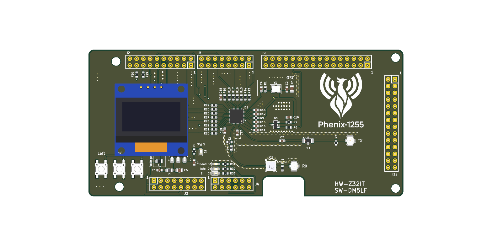
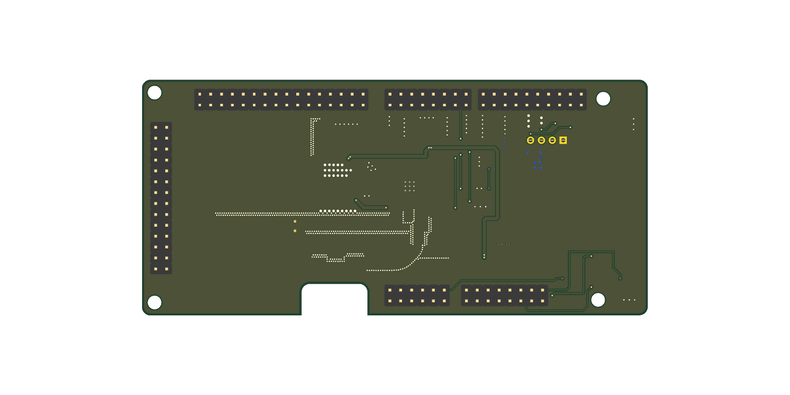
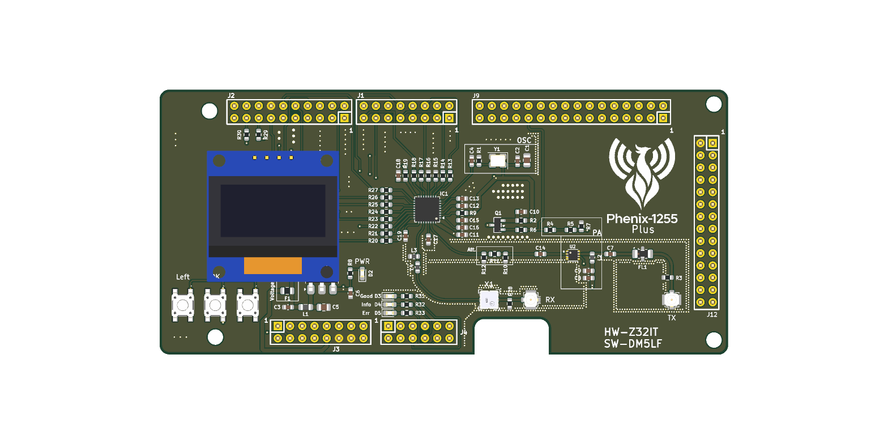
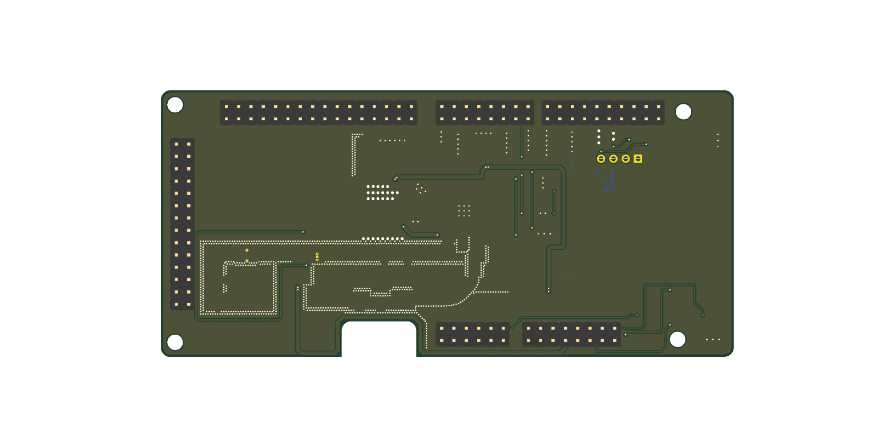

# Hardware

Description of the Phenix-1255 shield, revision **V2** and the **V2 Plus** variant (layout of
25 Nov 2026). The full schematics are in [`FRDM-SX1255-V2.pdf`](../FRDM-SX1255/FRDM-SX1255-V2.pdf)
and [`FRDM-SX1255+ V2.pdf`](../FRDM-SX1255+/FRDM-SX1255+%20V2.pdf); the firmware view of the same
signals is in
[`_doc/hardware.md`](https://github.com/w4tchd0g/phenix-1255-sw/blob/develop/_doc/hardware.md)
of the software repository.

<p align="center">
  
</p>

## Block overview

| Block | Parts | Description |
|---|---|---|
| Transceiver | IC1 (SX1255) | I/Q interface (I2S) and SPI to the MCX N947 |
| Reference clock | Y1 (38.4 MHz TCXO), C4, R1 | Clipped sine, 0.5–1 ppm, footprint fits 3225 and 2520 packages |
| RX path | JJ2, X1, L4, L3 | U.FL input → SAW band-pass (Tai-Saw TA0655A) → matching (L4 39 nH series, L3 82 nH shunt) → `RFI` |
| TX path | C7, FL1, JJ1 | `RFO_P` → 100 pF → low-pass (Mini-Circuits LFCN-490+) → U.FL output; `RFO_N` is AC-coupled to GND (C17) |
| TX driver amplifier (V2 Plus only) | U2, R4, R5, R7, R10–R12, L2, C8, C9, C14 | Qorvo TQP3M9036 between `RFO_P` and the low-pass filter, see [below](#tx-driver-amplifier-v2-plus) |
| PA supply switch | Q1, R2, R6, C10 | P-MOSFET (DMP1045U) switches the SX1255 PA supply (`VBAT3`) |
| Power supply | F1, D1, L1, U1, C1–C3, C5, C6 | 5 V → PTC fuse → TVS → ferrite bead → 3.3 V LDO |
| User interface | SW1–SW3, D2–D5, J7 | Push buttons, status LEDs, OLED socket |

## Shield headers

The shield plugs onto the FRDM-MCXN947 with six headers (J1, J2, J3, J4, J9, J12 on the PCB). The
pin numbers below are the shield's pin numbers (see the silkscreen). The MCU pins are taken from the
firmware's devicetree overlay. Pins not listed are not connected or GND.

The U.FL connectors are called JJ1 (*TX*) and JJ2 (*RX*), so "J1"/"J2" always mean the FRDM headers.

### J1 – SX1255 I/Q interface and control

| Pin | Signal | SX1255 pin | MCU pin | Function |
|---|---|---|---|---|
| 5 | `I_IN` | I_IN | P3_20 | SAI1_TXD0 – TX samples |
| 6 | `RST` | RESET | P0_29 | SX1255 reset |
| 9 | `CK_OUT` | CK_OUT | P3_18 | SAI1_RX_BCLK – I2S bit clock |
| 10 | `DIO1` | DIO1 | P0_30 | GPIO input |
| 13 | `DIO2` | DIO2 / WS | P3_19 | SAI1_RX_FS – I2S frame sync |
| 15 | `I_OUT` | I_OUT | P3_21 | SAI1_RXD0 – RX samples |
| 16 | `NSS` | NSS | P0_31 | SPI chip select, active low |

### J2 – SPI and OLED I²C

| Pin | Signal | MCU pin | Function |
|---|---|---|---|
| 2 | `DIO0` | P0_28 | SX1255 DIO0, GPIO input |
| 8 | `MOSI` | P0_24 | LPSPI1 SDO |
| 10 | `MISO` | P0_26 | LPSPI1 SDI |
| 12 | `SCK` | P0_25 | LPSPI1 SCK |
| 13 | `DIO3` | P0_19 | SX1255 DIO3, GPIO input |
| 15 | `SCL_oled` | P1_1 | LPI2C3 SCL |
| 17 | `SDA_oled` | P1_0 | LPI2C3 SDA |

The SX1255 signals have series resistors close to the SX1255:

| Value | Signals | Parts |
|---|---|---|
| 33 Ω | `RST`, `CK_OUT`, `I_OUT`, `MISO`, `DIO0`–`DIO3` | R13, R14, R18, R26, R23, R22, R21, R20 |
| 330 Ω | `I_IN`, `NSS`, `MOSI`, `SCK` | R17, R24, R25, R27 |
| 330 Ω to GND | SX1255 `CK_IN`, `Q_IN` (not used) | R15, R16 |

### J3 – Power and buttons

| Pin | Signal | MCU pin | Function |
|---|---|---|---|
| 1 | `BTN_LEFT` | P2_0 | Push button SW3 *Left* |
| 3 | `BTN_OK` | P1_22 | Push button SW2 *OK* |
| 4 | `+3.3V` | | 3.3 V of the FRDM board for the OLED socket and the buttons |
| 10 | `+5V0` | | Main supply of the shield |
| 12, 14 | GND | | |

### J4 – Button and status LEDs

| Pin | Signal | Colour | MCU pin |
|---|---|---|---|
| 1 | `BTN_RIGHT` – push button SW1 *Right* | | P4_12 / P0_21 |
| 6 | D3 *Good* | green | P0_14 |
| 8 | D4 *Info* | yellow | P0_22 |
| 10 | D5 *Err* | red | P0_15 |

The LEDs are driven active high through 1.5 kΩ resistors (R31 *Good*, R32 *Info*, R33 *Err*). D2
*PWR* is on the shield's 3.3 V rail (R8, 3.3 kΩ).

Where two MCU pins are listed, the FRDM board routes the header pin to one of them via a jumper or
resistor option. Check the FRDM-MCXN947 schematic for the default (the firmware uses P4_12 for
`BTN_RIGHT`; J4 pin 10 can also be routed to P2_0, which is already used by `BTN_LEFT`).

### J9 – PA enable

| Pin | Signal | MCU pin | Function |
|---|---|---|---|
| 23 | `~PA_EN` | P1_23 | PA supply enable, active low (V2 Plus: also enables the TX driver amplifier) |

The firmware reads a hardware ID from P1_19 (J9-5), P3_5 (J9-11) and P3_4 (J9-12) with internal
pull-downs. These pins are not connected on this board, so the ID reads 0.

### J12

Only GND (pin 2) is used.

## Other connectors

| Connector | Type | Use |
|---|---|---|
| JJ1 *TX* | U.FL | Transmitter output, 1 MΩ to GND (R3) |
| JJ2 *RX* | U.FL | Receiver input, 1 MΩ to GND (R28) |
| J7 *I2C OLED* | 1×4 socket, 2.54 mm | 1 GND · 2 +3.3V · 3 SCL · 4 SDA (33 Ω series resistors R29/R30) |

## Board functions

### Push buttons

SW1–SW3 switch to the FRDM 3.3 V rail and have no external pull-downs. Enable the **internal
pull-downs** on `BTN_LEFT`, `BTN_OK` and `BTN_RIGHT`; a pressed button reads as `1`.

### PA supply

The SX1255 PA supply (`VBAT3`) is fed from 3.3 V through R2 (1 Ω) and the P-MOSFET Q1
(Diodes DMP1045U), with C10 (1 µF) at the source. The gate is driven from `~PA_EN` through R6
(330 Ω); the PA is on while `~PA_EN` is low.

The gate has **no pull-up resistor** on the shield. While P1_23 is not driven (reset, before the
firmware configures it) the PA state is undefined, so the firmware should set `~PA_EN` high as
early as possible. The *bypass* solder jumper of earlier V2 layouts has been removed.

### TX driver amplifier (V2 Plus)

```
RFO_P ─ π-attenuator (R12 150 Ω / R11 36 Ω / R10 150 Ω) ─ C14 ─ U2 TQP3M9036 ─ C7 ─ FL1 LFCN-490+ ─ JJ1 TX
                                                                  │
                                                     +5V0 ─ L2 68 nH (bias feed)
```

- U2 is supplied from `+5V0` through L2 into its RF output (C8/C9 decoupling).
- U2 pin 6 is driven from `~PA_EN` through R4 (1 Ω) and R5 (33 kΩ) with R7 (10 kΩ) to GND, so the
  amplifier follows the PA enable signal.

### Power supply

```
J3-10 (+5V0) ─ F1 500 mA PTC ─┬─ L1 ferrite bead ─ U1 MCP1703 (3.3 V) ─ +3V3
                              └─ D1 TVS (SP0502BAHT)
```

C3 (1 µF) sits behind the fuse, C5 (22 µF) at the LDO input and C1 (22 µF), C2 (100 nF) and C6
(1 µF) at its output. The FRDM-MCXN947 supplies the 5 V. With a 48 V → 5 V USB-C PoE splitter the
setup can be powered over Ethernet.

## Changes in the layout of 25 Nov 2026

Compared with the V2 layout of 4 Nov 2026:

| Change | Before | Now |
|---|---|---|
| Reference designators | | Re-annotated. U.FL connectors are now JJ1/JJ2, the OLED socket is J7 |
| `~PA_EN` | J3-11 | J9-23 (P1_23) |
| `BTN_OK` / `BTN_RIGHT` | J4-1 / J3-3 | J3-3 / J4-1 |
| Status LEDs on J4-6 / -8 / -10 | *Err* / *Warn* / *Good* | *Good* / *Info* / *Err* |
| LED D4 | *Warn* | *Info* |
| `USB/LAN` (J3-13) | unused net on the header | removed |
| PA switch Q1 | BSS84, gate pull-up R4 10 kΩ, *bypass* jumper | DMP1045U, no pull-up, no jumper |
| Push buttons | C&K PTS647SK70SMTR2N LFS | E-Switch TL3305CF260QG (same footprint) |
| 22 µF capacitors | CL31B226MPHNNNE | CL21A226KOQNNNE |

The firmware on the `develop` branch of
[phenix-1255-sw](https://github.com/w4tchd0g/phenix-1255-sw) already uses the new pin assignment.

## Board views

| Top | Bottom |
|:---:|:---:|
|  |  |
|  |  |
