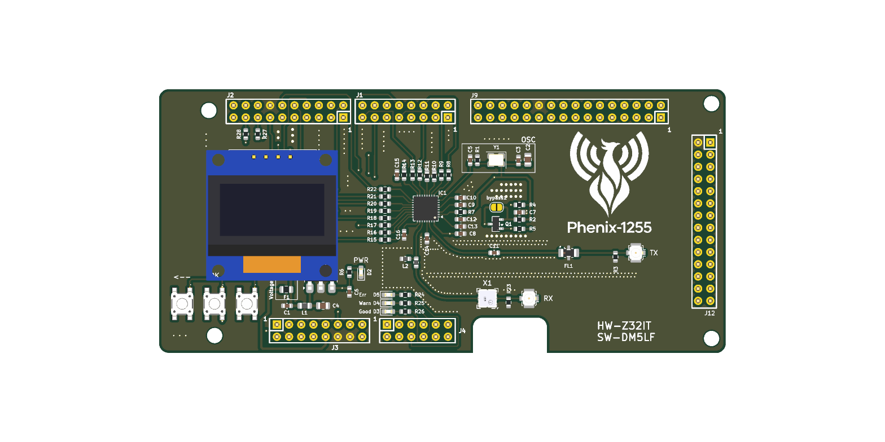
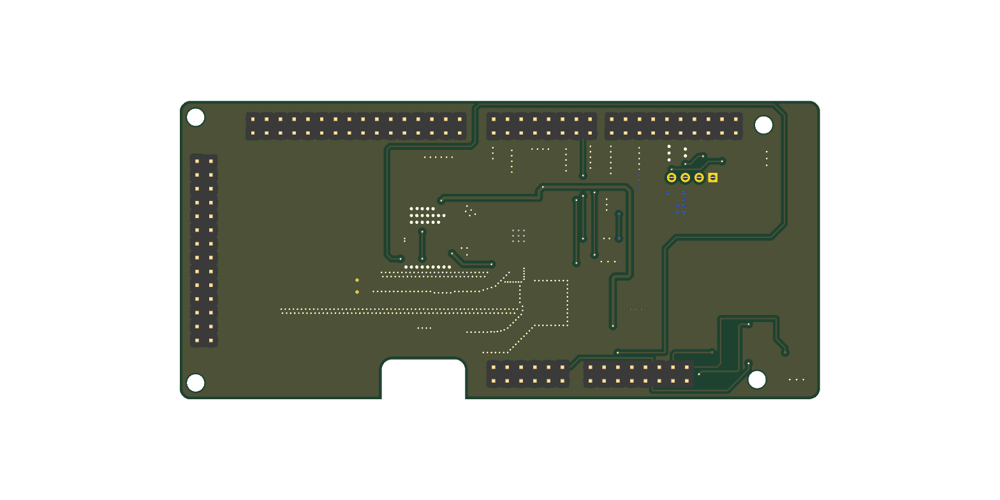
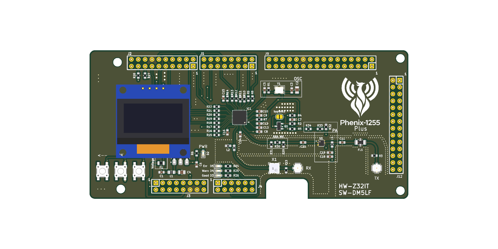
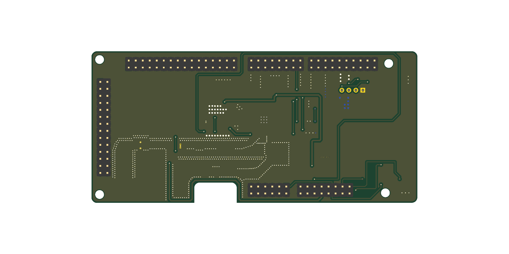

# Hardware

Description of the Phenix-1255 shield, revision **V2** and the **V2 Plus** variant. The full
schematics are in [`FRDM-SX1255-V2.pdf`](../FRDM-SX1255/FRDM-SX1255-V2.pdf) and
[`FRDM-SX1255+ V2.pdf`](../FRDM-SX1255+/FRDM-SX1255+%20V2.pdf); the firmware view of the same
signals is in
[`_doc/hardware.md`](https://github.com/w4tchd0g/phenix-1255-sw/blob/develop/_doc/hardware.md)
of the software repository.

<p align="center">
  
</p>

## Block overview

| Block | Parts | Description |
|---|---|---|
| Transceiver | IC1 (SX1255) | I/Q interface (I2S) and SPI to the MCX N947 |
| Reference clock | Y1 (38.4 MHz TCXO) | Clipped sine, 0.5–1 ppm, footprint fits 3225 and 2520 packages |
| RX path | J2, X1, L2, L3 | U.FL input → SAW band-pass (Tai-Saw TA0655A) → matching (L3 series, L2 shunt) → `RFI` |
| TX path | C11, FL1, J1 | `RFO_P` → 100 pF → low-pass (Mini-Circuits LFCN-490+) → U.FL output; `RFO_N` is AC-coupled to GND (C14) |
| TX driver amplifier (V2 Plus only) | U2, R29–R34, L4, C18–C20 | Qorvo TQP3M9036 between `RFO_P` and the low-pass filter, see [below](#tx-driver-amplifier-v2-plus) |
| PA supply switch | Q1, R2, R4, R5, *bypass* | P-MOSFET switches the SX1255 PA supply (`VBAT3`) |
| Power supply | F1, D1, L1, U1 | 5 V → PTC fuse → TVS → ferrite bead → 3.3 V LDO |
| User interface | SW1–SW3, D2–D5, J5 | Push buttons, status LEDs, OLED socket |

## Shield headers

The shield plugs onto the FRDM-MCXN947 with six headers (J1, J2, J3, J4, J9, J12 on the PCB). The
pin numbers below are the shield's pin numbers (see the silkscreen). The MCU pins are taken from the
firmware's devicetree overlay. Pins not listed are not connected or GND.

> **Note:** On V2 the U.FL connectors are also called J1 (*TX*) and J2 (*RX*). In this document
> "J1"/"J2" in the header tables mean the FRDM headers.

### J1 – SX1255 I/Q interface and control

| Pin | Signal | SX1255 pin | MCU pin | Function |
|---|---|---|---|---|
| 5 | `I_IN` | I_IN | P3_20 | SAI1_TXD0 – TX samples |
| 6 | `RST` | RESET | P0_29 | SX1255 reset |
| 9 | `CK_OUT` | CK_OUT | P3_18 | SAI1_RX_BCLK – I2S bit clock |
| 10 | `DIO1` | DIO1 | P0_30 | GPIO input |
| 13 | `DIO2` | DIO2 / WS | P3_19 | SAI1_RX_FS – I2S frame sync |
| 15 | `I_OUT` | I_OUT | P3_21 | SAI1_RXD0 – RX samples |
| 16 | `NSS` | NSS | P0_31 | SPI chip select, active low |

### J2 – SPI and OLED I²C

| Pin | Signal | MCU pin | Function |
|---|---|---|---|
| 2 | `DIO0` | P0_28 | SX1255 DIO0, GPIO input |
| 8 | `MOSI` | P0_24 | LPSPI1 SDO |
| 10 | `MISO` | P0_26 | LPSPI1 SDI |
| 12 | `SCK` | P0_25 | LPSPI1 SCK |
| 13 | `DIO3` | P0_19 | SX1255 DIO3, GPIO input |
| 15 | `SCL_oled` | P1_1 | LPI2C3 SCL |
| 17 | `SDA_oled` | P1_0 | LPI2C3 SDA |

All SX1255 signals have 33 Ω series resistors (R8–R22) close to the SX1255.

### J3 – Power, PA control and buttons

| Pin | Signal | MCU pin | Function |
|---|---|---|---|
| 1 | `BTN_LEFT` | P2_0 | Push button SW3 *←* |
| 3 | `BTN_RIGHT` | P1_22 | Push button SW1 *→* |
| 4 | `+3.3V` | | 3.3 V of the FRDM board for the OLED socket and the buttons |
| 10 | `+5V0` | | Main supply of the shield |
| 11 | `~PA_EN` | P2_4 | PA supply enable, active low |
| 13 | `USB/LAN` | P2_7 | Not connected on V2 (the slide switch of V1.3 was removed) |

### J4 – Button and status LEDs

| Pin | Signal | Colour | MCU pin |
|---|---|---|---|
| 1 | `BTN_OK` – push button SW2 *OK* | | P4_12 / P0_21 |
| 6 | D5 *Err* | red | P0_14 |
| 8 | D4 *Warn* | yellow | P0_22 |
| 10 | D3 *Good* | green | P0_15 |

The LEDs are driven active high through 1.5 kΩ resistors (R24–R26). D2 *PWR* is on the shield's
3.3 V rail.

Where two MCU pins are listed, the FRDM board routes the header pin to one of them via a jumper or
resistor option. Check the FRDM-MCXN947 schematic for the default (e.g. J4 pin 10 can also be
routed to P2_0, which is already used by `BTN_LEFT`).

### J9, J12

Only GND is used.

## Other connectors

| Connector | Type | Use |
|---|---|---|
| J1 *TX* | U.FL | Transmitter output, 1 MΩ to GND (R3) |
| J2 *RX* | U.FL | Receiver input, 1 MΩ to GND (R23) |
| J5 *I2C OLED* | 1×4 socket, 2.54 mm | 1 GND · 2 +3.3V · 3 SCL · 4 SDA (33 Ω series resistors R27/R28) |

## Board functions

### Push buttons

SW1–SW3 switch to the FRDM 3.3 V rail and have no external pull-downs. Enable the **internal
pull-downs** on `BTN_LEFT`, `BTN_OK` and `BTN_RIGHT`; a pressed button reads as `1`.

### PA supply and *bypass* jumper

The SX1255 PA supply (`VBAT3`) is fed from 3.3 V through R2 (1 Ω) and the P-MOSFET Q1 (BSS84).
R4 pulls the gate up, so the PA is **off** until the firmware pulls `~PA_EN` low (through R5).

The open solder jumper ***bypass*** bridges Q1. Closing it powers the PA permanently, independent
of the firmware.

### TX driver amplifier (V2 Plus)

```
RFO_P ─ π-attenuator (R29 150 Ω / R30 36 Ω / R31 150 Ω) ─ C20 ─ U2 TQP3M9036 ─ C11 ─ FL1 LFCN-490+ ─ J1 TX
                                                                  │
                                                     +5V0 ─ L4 68 nH (bias feed)
```

- U2 is supplied from `+5V0` through L4 into its RF output (C18/C19 decoupling).
- U2 pin 6 is driven from `~PA_EN` through R34/R33 with R32 to GND, so the amplifier follows the PA
  enable signal.

### Power supply

```
J3-10 (+5V0) ─ F1 500 mA PTC ─┬─ L1 ferrite bead ─ U1 MCP1703 (3.3 V) ─ +3V3
                              └─ D1 TVS (SP0502BAHT)
```

The FRDM-MCXN947 supplies the 5 V. With a 48 V → 5 V USB-C PoE splitter the setup can be powered
over Ethernet.

## Board views

| Top | Bottom |
|:---:|:---:|
|  |  |
|  |  |
